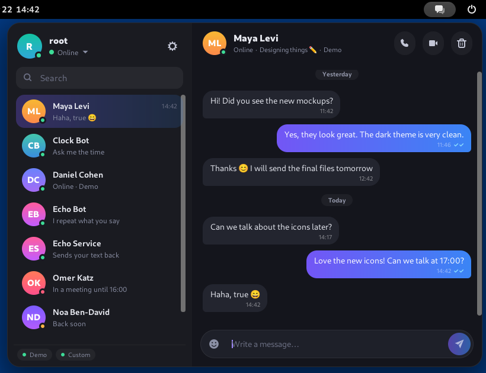
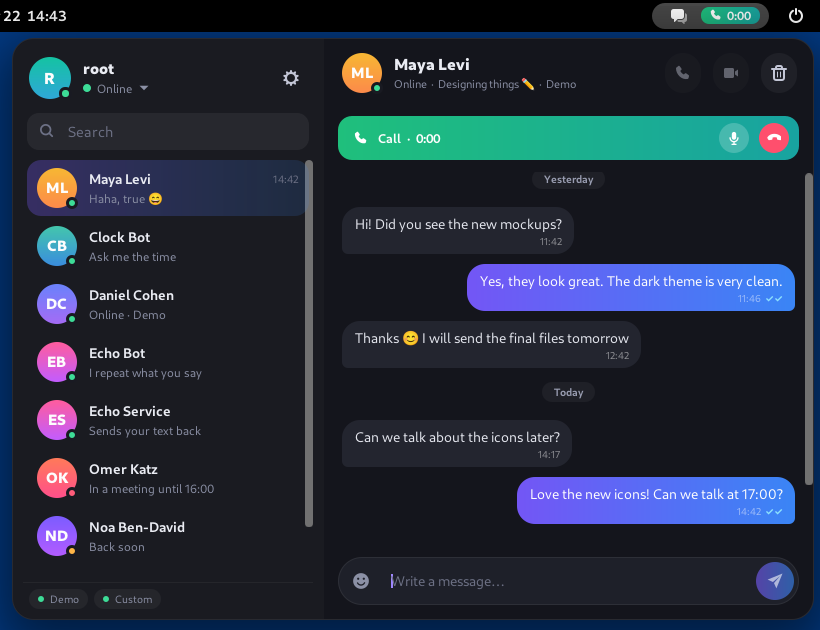
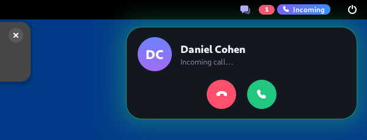
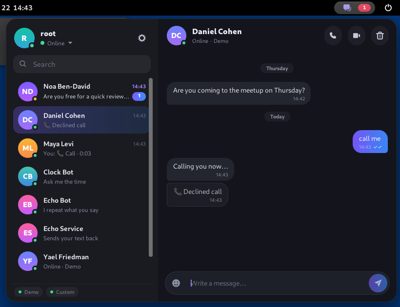

# Chat Hub

A chat window in the GNOME top panel (Ubuntu 23.10 and later, GNOME Shell 45 to 48).
All your chat accounts in one place: contacts with presence, chat history,
messages, typing, read marks and calls.

Jabber/XMPP and your own chat service connect through a small API.



| In a call | Incoming call | Unread messages |
|---|---|---|
|  |  |  |

## Features

- **Panel button** with an unread counter and a call timer.
- **Contact list**: search, presence dots, last message, time, unread badge.
  Recent chats come first.
- **Conversation**: message bubbles grouped by time, day separators,
  sent / delivered / read marks, "typing…", emoji panel, drafts per chat.
  Click a message to copy it. Click a failed message to send it again.
- **Chat history** on your computer, for every account
  (`~/.local/share/chathub/history`).
- **Calls**: call and video buttons, a call bar in the chat, and a call card
  at the top right of the screen with answer, decline, mute and hang up.
  Calls are written in the chat ("Call · 2:31", "Missed call").
- **Your profile**: name, picture and presence (Online, Do not disturb, Away,
  Invisible) for all accounts. "Do not disturb" mutes alerts.
- **Notifications** and sounds for new messages when the window is closed.
- Keyboard shortcut **Super+Alt+C** opens the window.
- **Demo account** with sample contacts, so you can try everything at once.
  Write "call me" to a demo contact to get an incoming call.

## Install

```sh
git clone -b chat-hub-extension https://github.com/alonlot/elen2.0 chat-hub
cd chat-hub
./install.sh
```

Then log out and log in again (on Wayland GNOME Shell cannot restart in place).
If the icon does not show: `gnome-extensions enable chathub@alonlot.github.io`.

Settings: click the gear in the chat window, or run
`gnome-extensions prefs chathub@alonlot.github.io`.

## Connect a chat network

Chat Hub talks to networks through **providers**. See [docs/API.md](docs/API.md).

### Jabber / XMPP

```sh
sudo apt install python3-slixmpp      # or: pip install --user slixmpp
mkdir -p ~/.config/chathub
cat > ~/.config/chathub/jabber.toml <<'EOF'
jid = "me@example.org"
password_command = "secret-tool lookup service chathub-jabber"
EOF
secret-tool store --label="Chat Hub Jabber" service chathub-jabber   # type the password
./install.sh --jabber
```

The Jabber backend supports contacts, presence, messages, typing, delivery
receipts and messages from your other devices. It does **not** support calls
(XMPP calls need a media stack).

### Your own chat service

Copy `backends/example_custom.py`. Change the parts marked `YOUR NETWORK`.
Run it with `python3 my_backend.py`. Chat Hub shows the new account at once.
To start it with your session, add it like `install.sh --custom` does.

A backend is a normal program that talks D-Bus, so you can write it in any
language. The Python SDK (`backends/chathub_backend.py`) has no dependency
other than PyGObject, which Ubuntu has by default.

## Layout

```
chathub@alonlot.github.io/   the extension
  extension.js               start, stop, wiring
  lib/api.js                 provider API and data model
  lib/manager.js             accounts, conversations, unread, calls
  lib/history.js             chat history on disk
  lib/dbusBridge.js          backends in other languages (D-Bus)
  providers/                 in-process providers (demo)
  ui/                        panel button, chat window, call card, notifications
  prefs.js                   settings window
backends/                    Python SDK, custom example, Jabber backend
tests/                       tests (see below)
docs/API.md                  how to add a chat network
```

## Tests

```sh
gjs -m tests/test_core.js           # API, history, manager
tests/run_dbus_test.sh              # D-Bus bridge with the Python backends
tests/run_jabber_test.sh            # Jabber end to end (needs a local XMPP server,
                                    # users alice/alicepw and bob/bobpw on localhost)
```

## Limits

- Tested on GNOME Shell 46 (Ubuntu 24.04). The code also supports 45, 47 and 48,
  but I did not run it on them.
- Calls: Chat Hub shows the call UI and sends start, answer, mute and hang up
  to the backend. The backend must handle audio and video. The demo and the
  custom example only simulate a call.
- Group chats, file transfer and message editing are not in the API yet.
